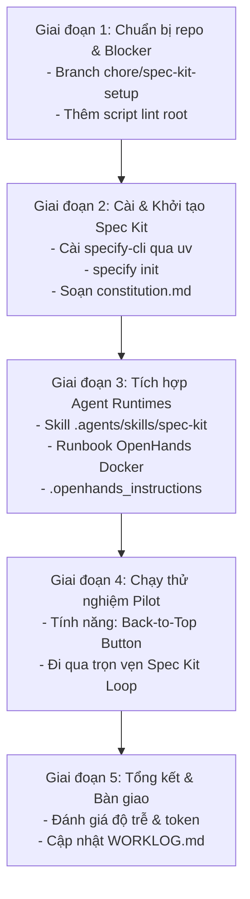

# Kế Hoạch Triển Khai OpenHands + GitHub Spec Kit Cho HacDaoTruyen

> **Phiên bản:** 1.0  
> **Ngày lập:** 2026-10-18  
> **Người thực hiện:** Antigravity Agent & User  
> **Mục tiêu:** Tích hợp quy trình phát triển tự động bằng Agent Loop (GitHub Spec Kit) vào repository `HacDaoTruyen`, kết hợp tối ưu phần cứng (Intel Core i5-14600K, 32GB RAM, RTX 4060, Docker WSL2, Native CLI).

---

## 1. Bối cảnh & Mục tiêu

- **Mục tiêu:** Xây dựng quy trình khép kín từ mô tả tính năng bằng ngôn ngữ tự nhiên đến code hoàn chỉnh, tự kiểm thử và tự sửa lỗi:
  $$\text{Feature Request} \xrightarrow{\text{Spec Kit}} \text{Spec} \to \text{Plan} \to \text{Tasks} \xrightarrow{\text{Agent Loop}} \text{Code} \to \text{Test} \to \text{Done}$$
- **Môi trường triển khai:**
  - **Máy trạm:** Intel Core i5-14600K (14C/20T), 32GB RAM, RTX 4060 (8GB VRAM), Windows 11 Pro, WSL2 (Docker Desktop).
  - **Repository:** `HacDaoTruyen` (React 18 + Vite, Cloudflare Workers ESM, Python 3.11).
  - **Mô hình kiến trúc:** **Hybrid 2 tầng**:
    - **Tầng 1 (Native Agent Loop):** Antigravity / Claude Code chạy trực tiếp trên Windows PowerShell để tối ưu 100% tốc độ I/O và kế thừa môi trường test hiện hữu.
    - **Tầng 2 (Docker Sandbox / Web UI):** OpenHands chạy trong Docker container phục vụ các tác vụ tự động dài hơi (unattended / overnight tasks).

---

## 2. Lộ trình triển khai chi tiết (5 Giai đoạn)



---

### Giai đoạn 1: Chuẩn bị Repository & Xử lý Blocker
- [ ] **1.1 Tạo branch riêng:** Checkout sang nhánh `chore/spec-kit-setup` từ `main`.
- [ ] **1.2 Bổ sung script `lint`:** Cập nhật root `package.json` với script:
  ```json
  "lint": "npm run lint --prefix frontend && node --check src/index.js"
  ```
- [ ] **1.3 Kiểm tra thử nghiệm lệnh lint:** Chạy `npm run lint` để đảm bảo hệ thống lint không có lỗi tồn đọng.

---

### Giai đoạn 2: Cài Đặt và Khởi Tạo GitHub Spec Kit
- [ ] **2.1 Cài đặt `specify-cli`:** Sử dụng `uv` trên Windows:
  ```powershell
  uv tool install specify-cli --from git+https://github.com/github/spec-kit.git
  ```
- [ ] **2.2 Khảo sát integration:** Kiểm tra các integration có sẵn qua `specify integration list`.
- [ ] **2.3 Khởi tạo Spec Kit trong repo:**
  - Chạy `specify init --here` với integration phù hợp (hoặc generic mapping commands vào `.specify/commands`).
- [ ] **2.4 Thiết lập Hiến pháp Dự án (`constitution.md`):** Tạo file `.specify/memory/constitution.md` mã hóa các quy tắc:
  - Kiến trúc: React 18, Vite, Cloudflare Worker (ESM), Python 3.11.
  - An toàn: Cấm tuyệt đối chạy deploy lên Cloudflare production từ sandbox; cấm commit secret.
  - Định nghĩa hoàn thành (Definition of Done): Lint 0 lỗi, cú pháp Worker hợp lệ, unit tests pass (`npm test`).

---

### Giai đoạn 3: Tích Hợp Lệnh Vào Agent Runtimes

#### A. Tích hợp Native Agent (Antigravity / Claude Code)
- [ ] **3.1 Tạo Skill Spec Kit nội bộ:** Xây dựng skill `.agents/skills/spec-kit/SKILL.md` để Antigravity nhận diện trực tiếp các lệnh Spec Kit:
  - `/speckit.constitution`: Xem/cập nhật quy ước dự án.
  - `/speckit.specify`: Phân tích yêu cầu, sinh `specs/<feature>/spec.md`.
  - `/speckit.plan`: Nghiên cứu kỹ thuật, sinh `specs/<feature>/plan.md`.
  - `/speckit.tasks`: Chia nhỏ task có kiểm thử vào `specs/<feature>/tasks.md`.
  - `/speckit.implement`: Triển khai code từng task.
  - `/speckit.converge`: Tự kiểm thử, sửa lỗi đối chiếu với spec.
- [ ] **3.2 Cập nhật tài liệu phối hợp:** Đồng bộ hướng dẫn vào [CLAUDE.md](file:///e:/AOO/HacDaoTruyen/CLAUDE.md) và [.agents/AGENTS.md](file:///e:/AOO/HacDaoTruyen/.agents/AGENTS.md).

#### B. Tích hợp OpenHands (Docker Sandbox / Web UI)
- [ ] **3.3 Tạo file cấu hình OpenHands:** Tạo `.openhands_instructions` ở thư mục gốc để OpenHands hiểu bối cảnh và cấm chạm production.
- [ ] **3.4 Soạn Runbook khởi động OpenHands:** Hướng dẫn lệnh Docker chạy OpenHands trên Windows/WSL2 mount workspace an toàn.
- [ ] **3.5 Cấu hình Model Routing:**
  - Phase 1 & 2 (Spec, Plan): Gemini 1.5 Pro / Claude 3.5 Sonnet.
  - Phase 4 & 5 (Code, Fix): Gemini 1.5 Flash hoặc Ollama local (`qwen2.5:7b` qua RTX 4060).

---

### Giai đoạn 4: Thử Nghiệm Pilot Đầu Tiên

- [ ] **4.1 Chọn tính năng thử nghiệm:** 
  - **Tên tính năng:** Nút "Cuộn lên đầu trang" (Back to Top Button) trên trang đọc truyện `Reader.jsx`.
  - **Phạm vi:** Frontend React Component + CSS + Unit Test bằng `node --test`.
- [ ] **4.2 Thực thi vòng lặp Spec Kit:**
  1. `specify`: Viết đặc tả tính năng UI/UX và hành vi scroll.
  2. `plan`: Thiết kế component, state hiển thị, gắn sự kiện scroll tối ưu debouncing.
  3. `tasks`: Chia task code component + unit test.
  4. `implement`: Agent triển khai code.
  5. `test & converge`: Chạy `npm run lint` và `npm run test:frontend` xác nhận.

---

### Giai đoạn 5: Đánh Giá, Bàn Giao & Ghi WORKLOG

- [ ] **5.1 Đo lường hiệu quả:** Đánh giá thời gian hoàn thành, số lượt lặp (iterations), chi phí token.
- [ ] **5.2 Ghi nhận WORKLOG:** Thêm dòng ghi nhận vào [.agents/WORKLOG.md](file:///e:/AOO/HacDaoTruyen/.agents/WORKLOG.md) theo đúng quy tắc phối hợp agent của repo.

---

## 3. Quản Trị Rủi Ro & Cơ Chế An Toàn

| Rủi ro | Mức độ | Biện pháp kiểm soát |
|---|---|---|
| Agent vô tình gọi deploy production | **Cao** | Khóa lệnh trong `constitution.md` và `.openhands_instructions`. Mọi lệnh `deploy` bị cấm hoàn toàn trong runtime agent. |
| Lộ secret API keys qua sandbox | **Cao** | `.gitignore` đã chặn; không mount `.env` thật vào Docker container; chỉ dùng mock token khi test. |
| Xung đột nhánh `main` với các agent khác | **Trung bình** | Luôn làm việc trên nhánh `chore/spec-kit-setup`; rebase trước khi merge. |
| Docker mount ổ E: bị chậm I/O | **Thấp** | Ưu tiên dùng Native Loop cho công việc thường ngày; chỉ dùng Docker khi cần sandbox tách biệt. |
